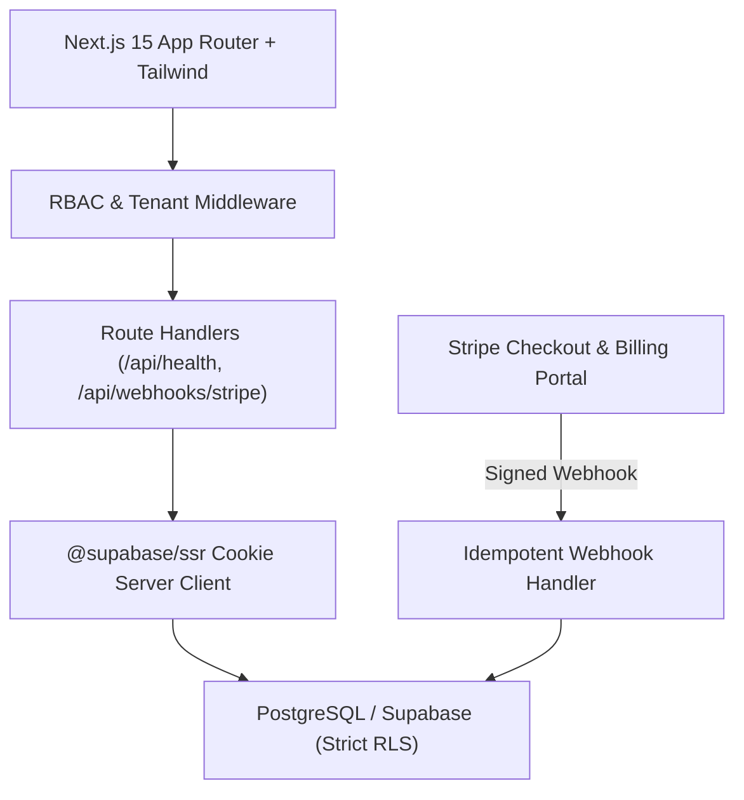

# Next.js + Supabase Multi-Tenant SaaS MVP Starter

[](.github/workflows/ci.yml)
[](package.json)
[](sql/multi_tenant_rls_schema.sql)
[](LICENSE)

> **Repeatable multi-tenant B2B SaaS foundation engineered for rapid 7-14 day launches without compromising database isolation, RBAC, or Stripe payment integrity.**

Modeled on proven Next.js App Router + Supabase SSR multi-tenant SaaS architectures, this starter gives founders and engineering teams a clean Day-1 production scaffold.

---

## Core Architecture



---

## Project Structure

```text
nextjs-supabase-saas-mvp-starter/
├── .github/workflows/ci.yml                 # Automated structural & security checks
├── sql/multi_tenant_rls_schema.sql          # Base organizations, memberships & webhook ledger
├── supabase/migrations/0001_multi_tenant_rls.sql  # Admin helper & write RLS policies
├── src/
│   ├── app/
│   │   ├── layout.tsx                       # Root App Router layout
│   │   ├── page.tsx                         # Multi-tenant module readiness landing UI
│   │   └── api/
│   │       ├── health/route.ts              # Safe runtime configuration health check
│   │       └── webhooks/stripe/route.ts     # Stripe signature-verified webhook route
│   ├── lib/
│   │   ├── supabase/server.ts               # Cookie-aware SSR client under caller RLS
│   │   ├── supabase/client.ts               # Browser client helper
│   │   └── stripe-webhook.example.ts        # Idempotent event ledger processor
│   └── middleware/rbac.example.ts           # Organization membership guard
├── tests/verify_structure.mjs               # Zero-dependency Node test suite
├── next.config.ts                           # Security headers (DENY framing, nosniff)
├── package.json
└── .env.example
```

---

## Quick Start

```bash
cp .env.example .env.local
npm install
npm test
npm run dev
```

Apply database migrations in your Supabase SQL Editor or CLI:
1. Run [`sql/multi_tenant_rls_schema.sql`](sql/multi_tenant_rls_schema.sql)
2. Run [`supabase/migrations/0001_multi_tenant_rls.sql`](supabase/migrations/0001_multi_tenant_rls.sql)

---

## Book a 14-Day SaaS MVP Sprint (`USD 5,000 - 15,000`)
- **LinkedIn Studio:** [Golden Nodalix Studio](https://www.linkedin.com/in/agency-golden-nodalix-880598438/)
- **Profile Hub:** [agenciaiaonline-wq](https://github.com/agenciaiaonline-wq)
- **Email:** `studio@example.com`
